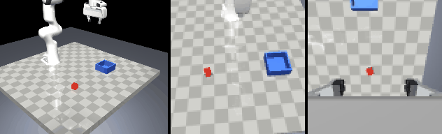
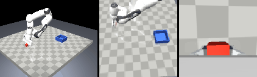

# panda-pick-place-il

[](https://github.com/dcgursoy/panda-pick-place-il/actions/workflows/ci.yml)

An imitation learning study on a simulated Franka Panda: a cube is picked up and
placed in a bin, demonstrated by a human through keyboard or gamepad teleop in
MuJoCo, and learned by behavior cloning (MLP and ResNet18) and by Diffusion
Policy (Chi et al. 2023), both written as plain PyTorch, with a Stable Baselines3
SAC agent as the reinforcement learning baseline. Every method is trained with
several seeds and evaluated on the same 100 held-out initial conditions, with
bootstrap confidence intervals, a success-versus-demos curve, a human-versus-
scripted demo ablation and a robustness test. The dataset tooling (multi-rate
logger, Zarr format, timestamp sync, validator, replay, LeRobot export) is our
own, and LeRobot's Diffusion Policy trained on the exported data serves as a
cross-check.



> Status: **milestone 6 of 8 (SAC baseline: 0 % success at 1 M env steps on three seeds, documented in [docs/milestone-logs/m6.md](docs/milestone-logs/m6.md)).** The study runs on the scripted demonstrations: one human teleop episode was recorded as a pipeline showcase (below) and the author chose not to record the 220-episode human dataset, so the human-versus-scripted ablation is out of scope (DESIGN.md, decision 17). [DESIGN.md](DESIGN.md) holds the
> design decisions, the alternatives considered and the milestone plan;
> [RESULTS.md](RESULTS.md) will hold the raw data behind every number reported
> here, with the command that produced it; [docs/milestone-logs/](docs/milestone-logs/)
> is the verification log of each milestone.

## Hardware this was built on

Windows 11, Intel Core Ultra 7 258V with its integrated Intel Arc 140V GPU (no
CUDA). Training runs on the iGPU through PyTorch's XPU backend, which is 15 to
40 times faster than the CPU for the ResNet18 / UNet models here (measured in
[docs/milestone-logs/m0.md](docs/milestone-logs/m0.md)). CPU-only runs work but
are impractical for the image-based policies.

## Setup

1. Intel Arc & Iris Xe graphics driver **32.0.101.9150 or newer**. Intel
   requires at least 32.0.101.9033 for PyTorch 2.15; on an older driver the XPU
   backend returned silently wrong results on this machine, so the code refuses
   to use the XPU until `scripts/check_xpu.py` has passed.
2. [uv](https://docs.astral.sh/uv/). Everything else is installed by it.

```bash
uv sync                                  # main environment (Python 3.12, torch 2.15 XPU); CI uses --no-default-groups --group dev --group cpu
uv run python scripts/check_xpu.py       # CPU-vs-XPU equality checks; writes DATA_ROOT/xpu_check.json
uv run python scripts/fetch_assets.py    # vendors the Menagerie Panda into assets/ (already committed)
uv run python scripts/env_demo.py --gif  # scripted pick-and-place video of the environment
uv run pytest                            # unit tests
```

Heavy artifacts (datasets, checkpoints, TensorBoard runs, videos) live outside
the repository under `DATA_ROOT`, which defaults to `C:\robodata\panda-pick-place-il`
on Windows (`~/robodata/panda-pick-place-il` elsewhere) and can be set with the
`PANDA_IL_DATA_ROOT` environment variable or `--data-root`.

The LeRobot cross-check uses a second, isolated environment because LeRobot
0.6.1 pins an older torch:

```bash
cd tools/lerobot_env && uv sync
```

## Recording demonstrations

The teleop tool works end to end with a PlayStation pad; the human dataset of
the original plan was not recorded (one practice episode exists, see below),
so this section documents the tool.

```bash
uv run python -m panda_il.teleop.teleop --dataset human_v1 --operator "<your name>" --max-steps 1200
```

A MuJoCo window opens with the arm at its home pose. Keep that window in the
foreground; keys are read globally but ignored while another window is active.
The gamepad is used automatically when one is connected (check its mapping once
with `--calibrate`; the mapping lives in `configs/gamepad.yaml`).

| Key | Gamepad (PlayStation) | Action |
|---|---|---|
| N | circle | start a new episode: fresh random cube pose, recording begins |
| K | triangle | keep the episode (saved; the running count is printed) |
| X | square | discard the episode |
| G | cross | toggle the gripper |
| R | options | reset the scene without recording |
| Esc | share | quit |
| W / S, A / D, Q / E | left stick, triggers | move the gripper along x, y, z (hold) |
| arrows, [ ] | right stick | tilt and rotate the gripper (hold) |

An episode ends by itself once the cube rests in the bin (the window prints
"episode complete"); press K to keep it. `--max-steps 1200` caps a recording
at 60 s of simulation time (the default 300 is the scripted expert's limit);
the time limit used for training and evaluation is fixed afterwards from the
recorded demo lengths. Failed attempts can be kept too (they
are stored with `success=false` and excluded from training) or discarded.
Each episode is validated and replayable:

```bash
uv run python -m panda_il.data.validate --dataset human_v1
uv run python -m panda_il.data.replay --dataset human_v1 --episodes 0 1 2
uv run python -m panda_il.data.render --dataset human_v1 --episode 0 --gif
```

With the viewer window at its default size the loop runs at about 16 Hz
wall-clock on this laptop (the viewer's own drawing competes with the
observation cameras for the iGPU); the recorded timestamps are simulation
time, so the data is unaffected, the motion just looks a little slow. A
smaller viewer window helps.

The one human episode (`human_v1`, episode 0, PS4 controller, 5927 steps on
the author's first attempt) validates, replays bit-exactly and looks like
this from the grasp to the place, at 4x speed:



It is a pipeline showcase, not training data: every result in this study
comes from the scripted expert's demonstrations (`scripted_v1`).

## Training and evaluation

Every stage is one command; `--help` lists every option (dataclass configs
through [tyro](https://github.com/brentyi/tyro)). Runs go to
`DATA_ROOT/runs/<method>/<dataset>_<obs>_<subset>/seed<k>` with their resolved
config, TensorBoard events, checkpoints and a `summary.json`.

```bash
uv run python -m panda_il.data.splits --dataset scripted_v1 --val 20                       # fixed validation split (once per dataset)
uv run python -m panda_il.train.train_bc --train.dataset scripted_v1 --train.obs-mode state  # BC-MLP, action chunks
uv run python -m panda_il.train.train_bc --train.dataset scripted_v1 --train.obs-mode state --policy.pred-horizon 1 --policy.action-horizon 1 --train.run-name bc_single/scripted_v1_state_all/seed0
uv run python -m panda_il.train.train_diffusion --train.dataset scripted_v1 --train.obs-mode state                                # Diffusion Policy, state
uv run python -m panda_il.train.train_bc --train.dataset scripted_v1 --train.obs-mode image --train.batch-size 64               # BC-ResNet
uv run python -m panda_il.train.train_diffusion --train.dataset scripted_v1 --train.obs-mode image --train.batch-size 64        # Diffusion Policy, images
uv run python -m panda_il.train.train_diffusion --train.dataset scripted_v1 --train.obs-mode state --train.subset 50 --train.seed 1  # demo-count curve point
uv run tensorboard --logdir "C:/robodata/panda-pick-place-il/runs"
uv run python -m panda_il.eval.evaluate --checkpoint "<run dir>/last.pt" --ic-set dev_set_v1 --gifs 2    # 20 dev episodes, 2 GIFs
uv run python -m panda_il.eval.evaluate --checkpoint "<run dir>/last.pt" --ic-set eval_set_v1           # 100 held-out episodes, logged in docs/eval_ledger.jsonl
```

Ten environments run in lockstep during evaluation so that one batched
network call serves all of them; each episode is seeded from its initial
condition index, so a report is reproducible and independent of the batch
size. The milestone 5 log has the measured training speed and dev-set
success of every method on the scripted data
([docs/milestone-logs/m5.md](docs/milestone-logs/m5.md)).

## Layout

```
panda_il/          the package: env, teleop, data, policies, train, eval
scripts/           one-off commands: asset vendoring, XPU self-check, device benchmark
tests/             pytest suite
tools/lerobot_env/ the isolated LeRobot environment and its cross-check scripts
assets/            vendored MuJoCo Menagerie Panda (with LICENSE and PROVENANCE.md)
configs/           committed held-out initial-condition sets
docs/              milestone logs, figures and GIFs shown in this README
```

## Results

None yet; they are produced in milestone 7 and every number will be traced in
[RESULTS.md](RESULTS.md).
