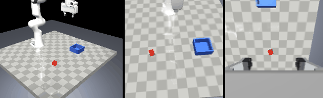

# Milestone 1: environment

Date: 2026-10-31. Same machine as M0 (Core Ultra 7 258V, Arc 140V iGPU, driver 32.0.101.8626).

## What was built

- `panda_il/env/scene.xml` + `scene.py`: table, 4 cm cube (free joint), open-top bin (inner 12 x 12 x 5 cm), two lights without shadows, a fixed `front` camera and a third-person `viewer` camera; the vendored Menagerie Panda attached at the origin through MjSpec with prefix `panda/`; a `tcp` site 0.1034 m along the hand's z axis (Franka's TCP) and a `wrist` camera on the hand; gravity compensation on every Panda body; a second, arm-only model for the IK reference.
- `panda_il/env/ik.py`: `MinkIK` (frame task on `tcp`, posture task, joint and velocity limits, daqp) and `DampedLeastSquaresIK` (fallback, MuJoCo only) behind one interface; `apply_delta` integrates the 7-D action into the commanded TCP pose (world-frame translation, local-frame rotation, workspace clamp).
- `panda_il/env/cameras.py`: camera clocks in integer substeps, a `CameraSet` that captures and delivers frames on schedule, intrinsics and point projection, a `ViewRenderer` for videos.
- `panda_il/env/task.py`: initial-condition sampling (square and band), the success predicate from contacts, reward terms for SAC.
- `panda_il/env/sets.py` + `scripts/make_eval_sets.py`: the committed held-out sets `configs/{eval_set_v1,dev_set_v1,robust_set_v1,robust_set_v1b}.json`.
- `panda_il/env/panda_env.py`: `PandaPickPlaceEnv` (gymnasium), registered as `PandaPickPlace-v0`, with `snapshot()`/`restore()` for exact continuation and `info["sim_state"]` (`mjSTATE_INTEGRATION`) for the logger.
- `scripts/env_demo.py` (scripted pick-and-place video), `scripts/time_env.py` (timing table); tests `tests/test_env.py`, `test_ik.py`, `test_cameras.py`, `test_task.py`.

## Exit criteria

| Criterion | Result |
|---|---|
| Determinism | `test_same_seed_and_actions_give_bitwise_identical_rollouts`: 60 random steps, two environments, every state observation and the final simulator state `np.array_equal`; `test_snapshot_and_restore_reproduce_the_trajectory_exactly`: continuation after `restore()` bitwise equal to the original. Image rollouts likewise (`test_image_rollouts_are_deterministic`). |
| IK tracking < 2 mm | square (4 x 10 cm) + vertical (2 x 10 cm) path at full speed, 5 hold steps per corner: worst settled error **1.26 mm (mink), 1.19 mm (DLS)**; kinematic IK error of the reference itself < 0.5 mm / 2 mrad at every 1 cm step; IK converges in 1 iteration; 0 resyncs. Lag while moving at the 0.2 m/s action limit: ~16 mm (position actuators, documented below). |
| `check_env` | passes in state mode (`skip_render_check=True`); the two warnings are gymnasium's generic ones about unbounded float observation spaces. |
| MP4 with both cameras | `DATA_ROOT/videos/m1_env_demo_seed0.mp4` (145 frames, viewer + front + wrist side by side); `docs/gifs/m1_env_demo.gif` (1.66 MB). The crude scripted controller succeeded: pick, carry and place in 144 control steps, 0 resyncs, cube final (0.502, 0.244, 0.025). |
| Timing table | below |
| Frame-age test | `test_delivered_frame_age_is_identical_across_reruns`: 3 seeds x 30 steps, the delivered age is always 10 substeps (20 ms) for both cameras, 0 at reset; `test_frames_arrive_on_schedule_and_never_early`: captures at substeps 15 and 40, the frame captured at 15 is not delivered at 22 and is delivered at 23. |

## Tests

```
$ uv run ruff check . && uv run ruff format --check .
All checks passed!
$ uv run pytest -q
53 passed, 2 skipped in 23.0s     (skipped: the two XPU equality tests, driver still below Intel's floor)
```

Of the 53, the rendering tests (`render` marker, 6 tests) ran locally and are skipped in CI.

## Timing (`scripts/time_env.py`, median over 100-200 calls)

| what | ms |
|---|---:|
| physics: 25 substeps (one control step) | 0.39 |
| IK solve, mink, 5 mm target step | 0.12 |
| IK solve, DLS, 5 mm target step | 0.10 |
| render front 96x96 | 9.82 |
| render wrist 96x96 | 9.84 |
| render viewer 480x384 | 11.17 |
| `env.step`, obs_mode=state | 0.88 |
| `env.step`, obs_mode=image | 21.44 |
| `env.step`, obs_mode=both | 21.63 |

The full step with both cameras uses 43 % of the 50 ms control period, so real-time teleop at 20 Hz has room for the viewer (~10 ms more, measured in the research pass) and logging. Rendering is latency-bound at ~10 ms per call regardless of resolution, as the research pass found.

## Held-out sets (`scripts/make_eval_sets.py`)

| set | kind | n | x range (m) | y range (m) | min front-image margin | min distance to other sets |
|---|---|---:|---|---|---:|---:|
| eval_set_v1 | square | 100 | 0.422..0.578 | -0.229..-0.071 | 21.6 px | 1.5 mm |
| dev_set_v1 | square | 20 | 0.429..0.571 | -0.223..-0.080 | 22.4 px | 1.5 mm |
| robust_set_v1 | band 8-12 cm | 100 | 0.381..0.619 | -0.269..-0.030 | 16.3 px | 4.3 mm |
| robust_set_v1b | band 12-16 cm | 100 | 0.345..0.658 | -0.310..0.009 | 11.4 px | 4.3 mm |

Bin rim corners: 10.4 px from the front-image border. All poses are inside the TCP workspace box. The streams are `numpy.default_rng([20261031, k])` with k = 1..4, recorded in each file.

## What failed first and how it was fixed

- **Gravity sag.** The first square-path run showed the TCP 2-7 mm below the command at rest and a growing lag that triggered the joint-space resync six times in 40 steps. Menagerie's Panda has position actuators without gravity compensation. Setting `body_gravcomp = 1` on the compiled model did nothing: MuJoCo counts compensated bodies at compile time (`ngravcomp`), so the flag has to be set on the spec bodies before `compile()`. With that, the rest error is 0 and the settled error 1.2-1.3 mm.
- **Resync criterion.** Joint-space drift between the open-loop IK reference and the measured joints reaches ~0.07 rad at full speed just from actuator lag, too close to the 0.1 rad threshold. The criterion is now task-space: resync when the measured TCP is more than 4 cm or 0.3 rad behind the reference (the lag at full speed is ~1.6 cm).
- **IK iteration cap.** The posture task leaves a sub-0.4 mm residual that the 0.1 mm tolerance never met; posture cost 1e-2 -> 1e-3 and tolerance 0.2 mm; the solve now converges in one iteration.
- **Front camera coverage.** The first placement left the far bin corner 3.1 px from the image border; the camera moved up (z 0.75 -> 0.84) and the field of view widened (45 -> 48 deg); margins are now >= 10 px. The cube is about 5 px wide in the 96x96 front image; the wrist camera provides the close-up.
- **State round trip.** Restoring only the simulator state does not reproduce a trajectory: the controller's open-loop IK reference and commanded pose are state too. `snapshot()`/`restore()` carry both, and the test is now bitwise.
- The TCP site marker was visible in the wrist image; it is now in site group 3, which the renderer does not draw (follow-up commit, demo regenerated).
- One transient test failure was observed in a single full run immediately after the demo video script had run in the same shell chain (1 failed, 52 passed); the pipeline's `tail` cut off the test name. Four subsequent full runs (53 passed each) did not reproduce it. Noted here so that a recurrence is investigated rather than dismissed; the run chains now print `FAILED` lines.

## Frames from the demo video

Left to right: third-person view, `front` camera (96x96, upscaled), `wrist` camera.
Start, grasp and release frames were inspected by eye: the cube and the bin are visible in the front view, the wrist view shows both finger pads with the cube between them at the grasp and the bin at release.


