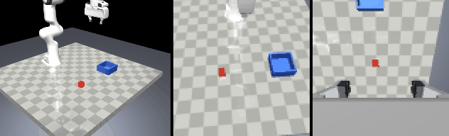

# Milestone 3: scripted expert, teleop, scripted dataset

Date: 2026-10-31 (overnight run). Driver 32.0.101.9150, XPU trusted.

## What was built

- `panda_il/teleop/expert.py`: `ScriptedExpert`, a privileged state machine (align with yaw matching, descend, grasp, lift, carry, lower, release, retreat) acting through the same 7-D interface as a human; `quantize="keyboard"` emits {-1, 0, +1} actions.
- `scripts/collect_expert.py`: evaluates the expert on random poses or a committed set, or records a scripted dataset (`source="scripted"`, operator `ScriptedExpert`, seeds from RNG stream 10) and validates it.
- `panda_il/teleop/keyboard.py` (pynput listener gated on the MuJoCo window being in the foreground), `panda_il/teleop/gamepad.py` (pygame-ce, mapping in `configs/gamepad.yaml`, `--calibrate`), `panda_il/teleop/teleop.py` (the 20 Hz session with 50 Hz input polling, N/K/X/G/R/Esc, running demo count, `--autopilot` for a human-free test, per-tick profiling).
- The replay and render tools from milestone 2 are the ones the brief lists under this milestone; they were exercised here on the scripted data.
- Tests: `tests/test_expert.py` (expert solves random poses in both modes, phases in order, quantisation levels), `tests/test_teleop.py` (keyboard jog and single-key semantics without a listener, gamepad mapping file, an autopilot session end to end).
- Pulled forward from milestone 4 while the recording ran: `panda_il/data/splits.py`, `stats.py`, `dataset.py`, `export_lerobot.py`, `tools/lerobot_env/crosscheck_dataset.py` (exercised in M4).

## Exit criteria

| Criterion | Result |
|---|---|
| expert >= 90 % on 50 random poses | **100 % (50/50)**, mean length 137 steps (128-146); keyboard-quantised variant 100 % (50/50), 139 steps (127-148) |
| expert on the committed sets (the ceiling rows for the robustness test) | eval_set_v1 100/100, robust_set_v1 100/100, robust_set_v1b 100/100, dev_set_v1 20/20; lengths 120-153 steps |
| teleop session works | autopilot sessions (headless and with the viewer window) start, record, keep and count episodes; keyboard listener starts and polls; recordings validate and replay exactly |
| replay reproduces a logged episode | scripted_v1 episodes 0, 50, 100, 150, 219: all bit-exact, same outcome, final cube distance 0.00 mm |
| scripted dataset | `scripted_v1`: 220 episodes, 220 successful, see below |
| hand-over | **the gamepad mapping check and the human recording wait for you** (README, "Recording demonstrations") |

## scripted_v1

`uv run python scripts/collect_expert.py --name scripted_v1 --n 220 --seed-stream 10`

```
dataset scripted_v1: 220 episodes, 220 successful, lengths 127-146 steps (mean 137.1)
max alignment error per stream: proprio 0.0 ms, priv 0.0 ms, cam_front 20.0 ms, cam_wrist 20.0 ms, action 0.0 ms
0 error(s), 13 warning(s) -> VALID
```

Recording took about 20 minutes (both cameras rendered); 515 MB on disk, 32,342 files (one per Zarr chunk). The 13 warnings are all held-out proximity notices: with 220 random poses in a 16 x 16 cm square that also holds 120 held-out poses, a few land within 5 mm of one (closest 4.4 mm / 2.1 deg of a dev pose, 4.6 mm / 1.6 deg of an eval pose). They are drawn from a different RNG stream, so this is chance, not leakage; the validator reports it so it stays visible, and the dev set is used for monitoring only. Replay of episodes 0, 50, 100, 150 and 219: bit-exact, same outcome.

Splits (`python -m panda_il.data.splits --dataset scripted_v1 --val 20`): 200 train, 20 validation, 0 failed. Nested subsets for the demo-count curve are prefixes of a seeded shuffle of the training ids (seed 0: 10 -> [5, 56, 96, 103, 104, 127, 140, 144, ...]).

Stats (`python -m panda_il.data.stats --dataset scripted_v1 --split train`, 200 episodes, 27,427 steps):

| action dim | min | max | mean | std | saturated |
|---|---:|---:|---:|---:|---:|
| dx | -1.000 | +1.000 | -0.040 | 0.326 | 0.09 |
| dy | -1.000 | +1.000 | +0.182 | 0.643 | 0.42 |
| dz | -1.000 | +1.000 | -0.280 | 0.705 | 0.50 |
| droll | 0 | 0 | 0 | 0 | 0 |
| dpitch | 0 | 0 | 0 | 0 | 0 |
| dyaw | -1.000 | +1.000 | +0.001 | 0.266 | 0.06 |
| gripper | -1 | +1 | +0.023 | 1.000 | |

The expert never rolls or pitches the gripper (those dimensions are constant and the normaliser maps them to 0, DESIGN.md decision 15), and it saturates the y and z axes about half the time: its action distribution is closer to a keyboard's than a stick's, which is one reason the human-vs-scripted ablation also runs the keyboard-quantised expert. Gripper closed 51 % of the steps.



## Teleop loop timing (`--autopilot`, 133 ticks)

| condition | env step, median / 90th pct (ms) | viewer sync (ms) | tick period (ms, target 50) |
|---|---:|---:|---:|
| headless (`--no-viewer`) | 24.5 / 28.1 | 0 | 49.8 / 54.2 |
| viewer window open, no mitigation | 105.1 / 138.9 | 1.1 | 127.2 / 140.5 |
| viewer open, viewer lock held during the step | 60.5 / 63.3 | 1.1 | 61.9 / 64.9 |

The passive viewer's render thread competes with the two offscreen camera renders for the iGPU (a controlled measurement: state-only steps are unaffected, 1.5 ms either way; image steps go from 22 to 109 ms with the viewer open, 43 ms with the lock held). With the lock the session runs at about 16 Hz wall-clock at the default window size. Recorded timestamps are simulation time, so the data is unaffected; the operator sees slightly slow motion. A smaller viewer window helps; rendering both cameras in one offscreen pass (one readback instead of two) is the remaining optimisation, not done tonight.

## Tests

```
$ uv run ruff check . && uv run ruff format --check .
All checks passed!
$ uv run pytest -q
99 passed in 80 s (render, viewer-free, and XPU equality tests included)
```

## What failed first and how it was fixed

- The first teleop profile with the viewer open ran at ~9 Hz. Measured separately: GPU contention between the viewer's thread and the offscreen renders (see the table). Holding the viewer lock for the whole step halves the cost; the rest is documented and left.
- `test_image_rollouts_are_deterministic` failed once with three differing pixels in one wrist frame out of twenty-one, while the dataset recording was using the same iGPU; the simulator states were bitwise identical and rendering one state five times was identical. The test now tolerates at most 0.1 % differing pixels per frame (real divergence shows up as whole regions, not three pixels) and keeps the bitwise state check. This is almost certainly also the "transient failure" noted in the M1 log.
- Two of my own test assumptions were wrong (the episode terminates on success before the expert's final phase; a fake key object was not a pynput `KeyCode`); fixed in the tests.
