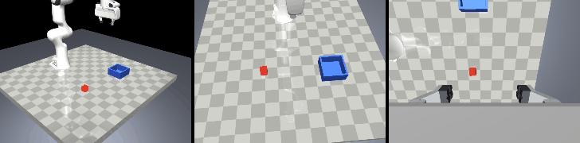

# Milestone 5: policies, training and evaluation (verified on scripted data)

Date: 2026-10-31 (overnight run, continued; the training queue ran 04:08 to 08:39). Driver 32.0.101.9150, XPU trusted. The run directories record the code as commit `59c8f5d` + uncommitted changes; those changes are exactly the milestone 5 commit that carries this log.

## What was built

- `panda_il/policies/normalize.py` (min-max normaliser as module buffers, image scaling), `obs_encoder.py` (state or proprio + per-camera ResNet18-GN / SpatialSoftmax features, random crop in training, centre crop at evaluation), `bc.py` (chunk-regression head, `pred_horizon = 1` for the single-step ablation), `checkpoint.py` (rebuild a policy from a checkpoint).
- `panda_il/policies/diffusion/schedulers.py` (DDPM squared-cosine 100 steps, DDIM eta 0), `ema.py`, `policy.py` (ConditionalUnet1D from milestone 0, FiLM on the encoder output; DDIM-10 by default, DDPM-100 as an option). The schedulers match `diffusers` to 1e-5 on `add_noise`, every DDPM step and 10- and 16-step DDIM trajectories (`tests/test_policies.py`).
- `panda_il/train/loop.py` + `train_bc.py` + `train_diffusion.py`: the shared protocol (AdamW 1e-4 / wd 1e-6 / betas 0.95, 0.999, fused on the XPU; cosine with 500 warm-up; EMA; bf16 autocast; dataset in RAM), TensorBoard, checkpoints every 5k + `last.pt`, optional dev-set rollouts during training, `config.json` / `summary.json` per run.
- `panda_il/eval/evaluate.py`: batched lockstep rollouts (10 envs), every episode seeded from (eval seed, IC index) including its diffusion noise, JSON report with per-episode outcomes and labels, GIFs, timing, git state; held-out evaluations append to `docs/eval_ledger.jsonl`. `panda_il/eval/failures.py`: the failure decision tree (grasp event, release event, where the cube ended).
- Tests: `tests/test_policies.py`, `tests/test_failures.py`, `tests/test_train_eval.py` (training smoke on a synthetic dataset, checkpoint round trip, per-episode noise independent of batch composition, evaluator lockstep + reproducibility, frame composition).

## Exit criteria

| Criterion | Result |
|---|---|
| loss curves | TensorBoard events in every run directory (`train/loss`, `val/loss`, `train/lr`, `train/ms_per_step`, `dev/success_rate`); the table below has the 1k-step and final values |
| dev-set success of each method trained on scripted demos | BC-MLP 100 %, BC-MLP single-step 90 %, DP-state 95 %, BC-ResNet 100 %, DP-image 90 % (20 dev episodes each, seed 0) |
| no held-out set touched | only `dev_set_v1` was evaluated; `docs/eval_ledger.jsonl` does not exist |
| measured s/iter and evaluation minutes per method | tables below |

## The queue

One run per method on `scripted_v1` (200 training episodes, 26,027 windows; 20 validation episodes), seed 0, 20k steps, dev-set rollouts (20 episodes, 10 envs) every 5k steps, then the final evaluation with two GIFs:

```
uv run python -m panda_il.train.train_bc        --train.dataset scripted_v1 --train.obs-mode state --train.seed 0 --train.dev-eval-every 5000
uv run python -m panda_il.train.train_bc        --train.dataset scripted_v1 --train.obs-mode state --train.seed 0 --train.dev-eval-every 5000 --policy.pred-horizon 1 --policy.action-horizon 1 --train.run-name bc_single/scripted_v1_state_all/seed0
uv run python -m panda_il.train.train_diffusion --train.dataset scripted_v1 --train.obs-mode state --train.seed 0 --train.dev-eval-every 5000
uv run python -m panda_il.train.train_bc        --train.dataset scripted_v1 --train.obs-mode image --train.batch-size 64 --train.seed 0 --train.dev-eval-every 5000
uv run python -m panda_il.train.train_diffusion --train.dataset scripted_v1 --train.obs-mode image --train.batch-size 64 --train.seed 0 --train.dev-eval-every 5000
uv run python -m panda_il.eval.evaluate --checkpoint <run dir>/last.pt --ic-set dev_set_v1 --n-envs 10 --gifs 2
```

Run directories: `DATA_ROOT/runs/{bc,bc_single,diffusion}/scripted_v1_{state,image}_all/seed0`; stdout of every run in `DATA_ROOT/runs/logs/`.

## Training

| method | params (M) | batch | ms/step (median) | 20k steps incl. 4 dev evals | train loss 1k -> 20k | val loss 20k (min) | dev success at 5k / 10k / 15k / 20k |
|---|---:|---:|---:|---:|---:|---:|---|
| BC-MLP (state, chunk 16 / 8) | 0.6 | 256 | 7 | 2.5 min | 0.0292 -> 0.0071 | 0.0075 (0.0075) | 100 / 100 / 100 / 100 % |
| BC-MLP single-step (state, 1 / 1) | 0.6 | 256 | 6 | 2.5 min | 0.0142 -> 0.0016 | 0.0026 (0.0026) | 75 / 85 / 90 / 90 % |
| Diffusion Policy (state) | 16.7 | 256 | 90 | 31.8 min | 0.0455 -> 0.0028 | 0.0032 (0.0032) | 45 / 75 / 90 / 95 % |
| BC-ResNet (image, chunk 16 / 8) | 23.1 | 64 | 298 | 105.6 min | 0.0257 -> 0.0042 | 0.0058 (0.0057) | 95 / 100 / 100 / 100 % |
| Diffusion Policy (image) | 40.9 | 64 | 330 | 119.2 min | 0.0773 -> 0.0052 | 0.0052 (0.0048) | 0 / 35 / 80 / 90 % |

Losses are MSE on normalised actions (BC) or on the predicted noise (DP), so they are not comparable across the two families. Dataset load from Zarr: 27 s (state), 30 s and 105 s (image; the second image run loaded while the previous one's evaluation was still writing GIFs). Device: Intel Arc 140V through torch 2.15.0+xpu, bf16 autocast, fused AdamW.

The image runs are 1.5 to 1.7 times slower than the milestone 0 benchmark predicted (298 and 330 ms per step against 200 and 261): the benchmark timed the networks alone, a training step also crops, normalises and moves 256 images (2 cameras x 2 frames x batch 64), updates the EMA copy of 23 to 41 M parameters and runs the optimiser. The state runs match the benchmark. DESIGN.md section 7 has the re-fitted budget (about 100 laptop-hours for the full matrix).

## Dev-set evaluation (`dev_set_v1`, 20 episodes, eval seed 0, final EMA weights, limit 300 steps)

| method | success | mean steps of successes | failure labels | inference ms per batched call | env ms per step | wall |
|---|---:|---:|---|---:|---:|---:|
| BC-MLP (state, chunk) | 20 / 20 = 100 % | 141 | - | 14 | 3.9 | 13 s |
| BC-MLP single-step | 18 / 20 = 90 % | 139 | slipped in transit 2 | 3 | 3.7 | 14 s |
| Diffusion Policy (state), DDIM-10 | 19 / 20 = 95 % | 138 | slipped in transit 1 | 126 | 3.5 | 19 s |
| BC-ResNet (image, chunk) | 20 / 20 = 100 % | 138 | - | 115 | 25.2 | 75 s |
| Diffusion Policy (image), DDIM-10 | 18 / 20 = 90 % | 138 | never grasped 2 | 167 | 20.4 | 76 s |

The expert that produced the data takes 120 to 153 steps on these poses (milestone 3), so the successful policies are as fast as their teacher. Inference is one call per 8 executed steps for all 10 envs together (DP: 10 DDIM steps of the UNet plus the encoders); the image evaluations are dominated by the two camera renders per env step (20 to 25 ms), so 100 held-out episodes cost about 1.5 min for a state policy and 6.5 min for an image policy.

Failures, from the per-episode reports (`eval/dev_set_v1_s0.json`):

- BC-MLP single-step, ICs 9 and 17: grasped at step 61, lost the cube at step 109 with the gripper still commanded closed; the cube ended on the table between the pick region and the bin (y = 0.11 and 0.12 m). The classic compounding-error signature of single-step regression: the policy drifts during the carry until the cube slides out.
- DP-state, IC 2: the same slip, at step 73.
- DP-image, ICs 2 and 18: never grasped, cube still at its initial pose at the limit; this policy was still improving at 20k steps (dev success 0 / 35 / 80 / 90 %, validation loss still falling), so 20k steps at batch 64 is probably not its converged budget. A decision for the human-data matrix rather than something to tune on scripted data (see "Open point").
- No IK resync happened in any episode.



These numbers are a pipeline check on a deterministic expert's data, not a result: every method sees the same 200 demonstrations of a policy that succeeds 100 % of the time, and 20 episodes resolve nothing finer than 5 %. The experiments with seeds, confidence intervals and the held-out sets are milestone 7.

## Open point for milestone 7: the image training budget

DP-image was the only method still climbing at the end of its budget. Options, to decide once the human data exists: keep 20k steps for every image method (the protocol stays identical across BC-ResNet and DP-image, DP-image is reported as is), or raise the image budget for both image methods to 30k or 40k steps (3 to 4 h per run, 22 image runs in the matrix). The state budget looks adequate (BC-MLP flat from 5k, DP-state 90 to 95 % over the last two checkpoints).

## Tests

```
$ uv run ruff check . && uv run ruff format --check .
All checks passed!
$ uv run pytest -q
120 passed in 118 s (render and XPU tests included)
```

## What failed first and how it was fixed

- The checkpoint loader rebuilt the encoder config after popping its dict, so the camera list was always empty; an image checkpoint loaded as a proprio-only model and failed with UNet size mismatches. Found by the smoke evaluation, fixed, regression test added (`test_policy_config_round_trip_keeps_cameras`).
- The first evaluator drew the whole batch's diffusion noise from one generator, so an episode's sample depended on what else was in its batch; now one CPU generator per episode, seeded from the IC index (tested).
- The EMA test expected a decay of 0.9999 after 100k steps; with the reference schedule (1 + step)^-0.75 that takes 215k steps. Test fixed, implementation unchanged.
- `np.random.seed` is flagged by ruff as legacy; kept (third-party code may use the global RNG) with an explicit noqa.
- Training logs looked silent for minutes when redirected to a file: only the step lines flush. Cosmetic.
