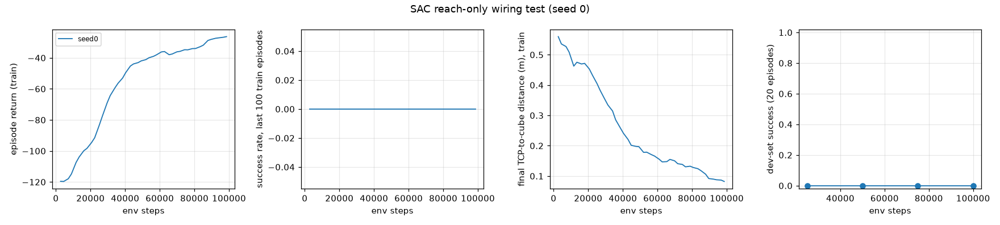
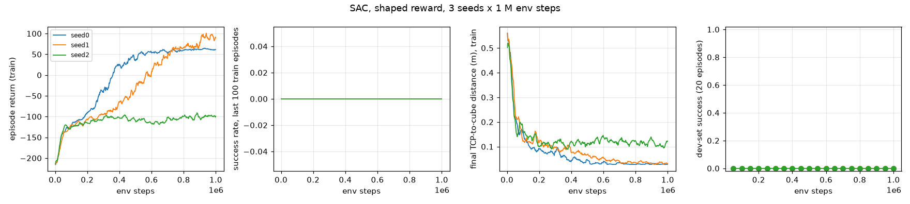

# Milestone 6: the SAC baseline

Date: 2026-11-01. CPU only (SB3 SAC with a 29-D state and a two-layer MLP does not benefit from the iGPU). The three full seeds ran from commit `e62f677`; the results and the `--resume` option were added in the milestone's second commit.

## What was built

- `panda_il/train/train_sac.py`: Stable-Baselines3 2.9.2 SAC on the same environment as the imitation-learning policies (`StateObservation` wrapper reduces the Dict observation to the 29-D state; `Monitor` for episode statistics; a `DummyVecEnv` of 4 envs; SB3 bootstraps through the 224-step truncation). Shaped reward from `RewardConfig` (reach, grasp, lift, place, success) or the reach-only variant (`--reward reach`). A callback logs the success rate and final TCP-to-cube distance of the last 100 training episodes and rolls the policy out on the dev set every 50k env steps through the batched evaluator. SB3's `progress.csv` + TensorBoard, checkpoints every 100k steps, `final.zip`, `config.json`, `summary.json` (env steps, wall clock, steps per second, dev curve). At start-up the trainer compares its env config with the one `scripted_v1` was recorded with and runs SB3's env checker on request.
- `panda_il/policies/sac_adapter.py`: presents a SAC model as a single-step state policy, so `eval/evaluate.py --checkpoint <run>/final.zip` evaluates SAC on the committed IC sets with the same limits, failure labels, GIFs and ledger as the IL policies.
- `panda_il/eval/plots.py`: SAC learning curves (training return, training success rate, final reach distance, dev-set success against env steps), one line per seed.
- Tests (`tests/test_sac.py`): wrapper spaces and SB3's `check_env`; reward variants; a 48-step training run with checkpoint, summary and CSV, loaded through `load_checkpoint` and rolled out by the evaluator. DESIGN.md section 15 describes the design.

## Exit criteria

| Criterion | Result |
|---|---|
| reach-only smoke test proves the wiring learns | 100k env steps, 54 min: final TCP-to-cube distance of the last 100 training episodes fell from 0.56 m (random policy) to 0.077 m, the episode return rose from -120 to -26, entropy coefficient annealed from 1 to 0.0016; curves in `docs/figures/m6_reach_wiring.png` |
| 20k-step throughput and extrapolation | 32 env steps/s (4 threads) and 30 (2 threads) with one gradient step per transition; 1 M steps = about 9.3 h per seed; three seeds run in parallel (2 threads each) |
| env config identical to the IL env | the trainer's check passes: same config as the `scripted_v1` recording apart from the reward and the recording cap; SB3 `check_env` ok |
| learning curves, env steps and wall clock, 3 seeds | three seeds x 1 M steps, 9.1 to 9.5 h each, curves in `docs/figures/m6_sac_curves.png`; **0 % success on every seed** (see "Results" below) |

## Throughput (`--total-steps 20000 --learning-starts 5000`, shaped reward, seed 0)

| torch threads | warm-up (random actions, env only) | with one gradient step per transition | 20k steps | 1 M steps |
|---:|---:|---:|---:|---:|
| 4 | ~283 env steps/s | 27 to 37 env steps/s | 10.5 min | ~9.3 h |
| 2 | ~290 env steps/s | 28 to 36 env steps/s | 11.2 min | ~9.5 h |

The environment alone runs at about 285 steps/s across 4 envs (3.5 ms per step: 25 physics substeps plus one IK solve); SAC's update (actor, two critics, targets, entropy coefficient; batch 256) costs about 30 ms per gradient step on this CPU and dominates once learning starts. Thread count barely matters, so the three seeds share the 8 threads. This is 2 to 4 times slower per seed than the plan's estimate of 2 to 4 h; the plan's budget of 1 M steps per seed is kept rather than lowering the update-to-data ratio, and the time is paid in parallel.

## Reach-only wiring test (`--reward reach --total-steps 100000 --learning-starts 5000`, seed 0)

| env steps | episode return | final TCP-to-cube distance (m), last 100 episodes | entropy coef |
|---:|---:|---:|---:|
| 2.7k (random) | -120 | 0.56 | 1 |
| 13k | -104 | 0.48 | 0.081 |
| 25k | -83 | 0.40 | 0.0043 |
| 48k | -43 | 0.20 | 0.0025 |
| 70k | -36 | 0.15 | 0.0021 |
| 100k | -26 | 0.08 | 0.0016 |



The distance is to the cube's centre (the cube is 4 cm wide), so 8 cm is "hovering next to it", still improving at the end. Dev-set success stays 0 % by construction (no incentive to grasp). This settles the wiring: observations, actions, IK, reward terms and SB3's truncation handling learn together.

## Full runs (3 seeds x 1 M env steps, shaped reward)

```
uv run python -m panda_il.train.train_sac --seed 0 --threads 2   # and seeds 1, 2, in parallel
```

Launched 2026-11-01 03:07, finished 12:40 to 13:00; results below.

## Tests

```
$ uv run ruff check . && uv run ruff format --check .
All checks passed!
$ uv run pytest -q
126 passed in 258 s (with three SAC processes running)
```

## Results: 3 seeds x 1 M env steps (shaped reward)

Each seed ran 1 M env steps on 4 envs with 2 torch threads, all three in parallel; `DATA_ROOT/runs/sac/shaped/seed{0,1,2}`.

| seed | wall clock | env steps/s | training episodes | return, last 100 episodes | final TCP-cube distance, last 100 | training success rate | dev-set success (20 episodes, every 50k steps) |
|---:|---:|---:|---:|---:|---:|---:|---|
| 0 | 9.5 h | 29 | 4464 | +61 | 0.028 m | 0 % | 0 % at every checkpoint |
| 1 | 9.5 h | 29 | 4464 | +90 | 0.031 m | 0 % | 0 % at every checkpoint |
| 2 | 9.1 h | 30 | 4464 | -99 | 0.12 m | 0 % | 0 % at every checkpoint |



**SAC did not solve the task within the budget.** No training or evaluation episode met the success predicate on any seed. What the final policies do, measured on 10 dev poses with the per-step reward terms (and the failure labels of the 20-episode evaluations in `eval/dev_set_v1_s0.json`):

| seed | steps with the grasp term on | steps with the lift term on | max cube height | closest TCP-cube approach | failure labels (20 dev episodes) |
|---:|---:|---:|---:|---:|---|
| 0 | 78 % | 0 % | 2.0 cm (resting) | 2.5 cm | never grasped 20 |
| 1 | 74 % | 19 % | 3.7 cm | 1.7 cm | never grasped 16, held at timeout 4 |
| 2 | 2 % | 0 % | 2.8 cm | 3.8 cm | never grasped 19, slipped in transit 1 |

The returns tell the story: a random policy scores about -213 (the reach and place distances summed over 224 steps). Seed 2 learned to approach the cube (the return rises to -100 by 150k steps and stays there). Seeds 0 and 1 found the shaping's local optimum: closing the gripper on the cube earns +1 per step from the grasp term, and seed 0 does exactly that, on 78 % of its steps, without ever lifting (the evaluator's "grasp event" needs a 2 cm lift, hence "never grasped" at 0 % success). Seed 1 lifts on 19 % of its steps (+1 more per step) and in 4 of 20 dev episodes is still holding the cube when the limit hits; it was still improving at 1 M steps (return +44 at 700k, +90 at 1 M). Nothing carried the cube to the bin: the place term's gradient (minus the planar distance to the bin, about -0.4 per step) is small next to holding still for +2 per step, and the +10 success bonus is never seen. This is the familiar failure mode of hand-shaped rewards for long-horizon manipulation, and it is reported as such rather than tuned away: the baseline is the plan's reward, run with the plan's budget.

What would be tried next with more compute, in order of expected value: a success bonus per step while the cube rests in the bin (or a larger one-off bonus); a budget of 2 M steps, since seed 1 was still climbing; a place-term weight above 1. None of these was run; the results table in milestone 7 reports SAC at 1 M steps with these three seeds, and the compute table lists its 3 x 1 M env steps and 28 h of CPU time next to the IL rows' 200 demonstrations (27k env steps of scripted data) and minutes of training.

For the record, the throughput over the full runs matched the smoke test (29 to 30 env steps/s with three processes sharing 8 threads), the dev-set rollouts cost about 25 s each, and the trainer gained `--resume` (continues a run's `final.zip`, with its replay buffer when saved) and now saves the replay buffer, so a 2 M-step extension is one command per seed.
